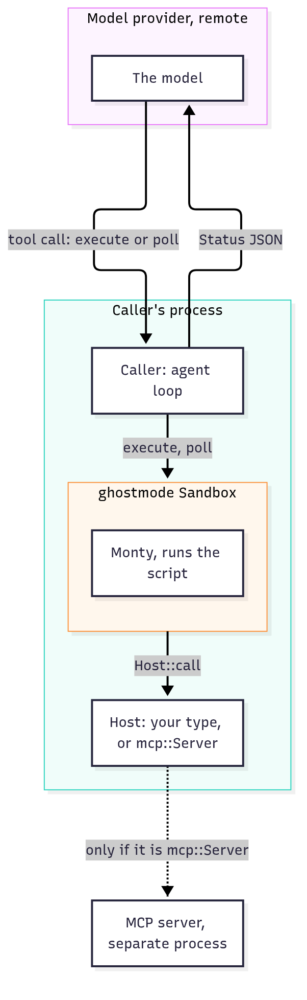

<p align="center"></p>
<p align="center"><a href="https://github.com/legend-of-alan/ghostmode/actions/workflows/ci.yml"></a> <a href="#license"></a> <a href="https://github.com/sponsors/legend-of-alan"></a></p>

# Ghost Mode

Ghost Mode is a Rust library that brings Code Mode to agents. With normal tool calls, every result goes back to the model before it can ask for the next one. Ghost Mode lets the model write a short Python script that chains the calls itself, so intermediate results never go back to the model.

Think about it like this: normal tool calling is like going back to the store 30 times to get 30 items. Code Mode is one trip with a shopping list.

Say the model needs to know why a pull request's checks failed. Each step needs the one before it. The pull request gives the commit, the commit gives the check runs, and each failed run gives a log. With normal tool calls, that's a round trip to the model per step, and every full result goes through the model. With Ghost Mode, the model sends one script:

```python
pr = get_pull_request(number=42)
runs = list_check_runs(commit=pr["head_sha"])
failed = [run for run in runs if run["conclusion"] == "failure"]
[{"check": run["name"], "log": get_log(run_id=run["id"])[-500:]} for run in failed]
```

The script runs inside your process. The model only gets the last 500 characters of each failed log, not the pull request, every check run, and every full log.

## Why Ghost Mode

- **Fewer tokens.** Anthropic cut one workflow from 150,000 tokens to 2,000 (98.7% less) by having the agent write code against its tools instead of loading every tool definition up front ([post](https://www.anthropic.com/engineering/code-execution-with-mcp)). Cloudflare fits its whole API, 2,500+ endpoints, into about 1,000 tokens, where plain MCP tools would take 1.17 million ([post](https://blog.cloudflare.com/code-mode-mcp/)).
- **API bills up to 70% lower.** Across eight models, code mode cut cost by 70.6% for GPT-5.4 and 40.7% on average ([benchmark](https://www.ijcaonline.org/archives/volume187/number136/mbat-ijca-2026-e10508249e55.pdf)). Intermediate results never reach the model, so you aren't billed for them as input on every later step.
- **Fewer steps, better results.** Models have read way more code than tool-call JSON. Across 17 models, CodeAct's code actions needed up to 30% fewer actions and scored up to 20 points higher success than JSON or text tool calls ([paper](https://arxiv.org/abs/2402.01030)).

> Savings depend on the model. In the eight-model benchmark, weaker models retried failed scripts until some runs cost more than plain tool calls, and Gemini models passed fewer tasks. A [pre-registered study](https://arxiv.org/abs/2611.19123) measured 70% to 90% fewer tokens with three open-weight models. In Ghost Mode, the `Limits` you build the `Sandbox` with cap how much any one result can add (40,000 characters by default).

Those are other teams' Code Mode numbers. Ghost Mode brings the same idea to Rust.

What it takes: give a `Sandbox` your tools, or point it at an MCP server, and hand the model only two tool definitions, `execute` and `poll`. The Monty backend runs the script inside your process, so there's no container or extra service. The script can only reach the outside world through your tools.

## How it works

<picture>
  <source media="(prefers-color-scheme: dark)" srcset="assets/how-it-works-dark.png">
  
</picture>

Here's who's who. Everything except the model and any MCP server lives in the caller's process.

- **The model** is the LLM. It runs at the model provider, never runs code, and only sees two tool definitions, `execute` and `poll`.
- **The caller** is your app, the agent loop. It owns a `Sandbox`, passes each `execute` or `poll` call from the model into it, and sends the `Status` JSON back.
- **The `Sandbox`** is a Ghost Mode library object in the caller's process. No separate service.
- **The script** is the Python the model wrote.
- **Monty** is the Python interpreter that runs the script, inside the caller's process.
- **The host** is the value you pass to `Sandbox::builder`. Its type implements `Host`, and it offers tools and answers calls to them.
- **A tool** is one function the host offers. The script calls it like a Python function, and the `Sandbox` turns that into `Host::call`. The host can do whatever it likes to answer, network calls included.
- **`mcp::Server`** is a ready-made host behind the `rmcp` feature. It wraps an rmcp client connection to an MCP server running somewhere else, and its tools are that server's tools.

Every arrow inside the caller's process is a plain Rust function call. The only network hops are caller to model provider, and `mcp::Server` to its MCP server.

## Usage

Write a host, build a `Sandbox`, and give the model the `execute` and `poll` definitions. When the model calls `execute`, pass its code to `Sandbox::execute` and send the `Status` JSON back. If the run is still going, the model calls `poll` with the `run_id`, and you pass that to `Sandbox::poll`.

```rust
use futures_util::future::{BoxFuture, FutureExt};
use ghostmode::host::{Call, Error, Host, Tool};
use ghostmode::{schema, Sandbox};
use serde_json::{json, Value};

struct Echo;

impl Host for Echo {
    fn tools(&self) -> Vec<Tool> {
        vec![Tool {
            id: "echo".into(),
            description: "Returns the text you pass it.".into(),
            input_schema: json!({
                "type": "object",
                "properties": { "text": { "type": "string" } },
                "required": ["text"],
            }),
        }]
    }

    fn call(&self, call: &Call) -> BoxFuture<'static, Result<Value, Error>> {
        let text = call.args.get("text").cloned().ok_or_else(|| Error::Failed("text is required".into()));
        async move { text }.boxed()
    }
}

let host = Echo;
let tools = schema::list_mcp_tools(&host.tools());
let mut sandbox = Sandbox::builder(host).build().await;
// Hand `tools` to the model. When it calls execute, run the code and send the Status JSON back.
let status = sandbox.execute("echo(text='hello')", false).await;
let reply = serde_json::to_value(&status).unwrap();
```

`schema::list_mcp_tools` gives you the pair in MCP shape, and `schema::list_openai_functions` gives them as OpenAI functions. With the `rmcp` feature on, pass an `mcp::Server` to `Sandbox::builder` instead of writing your own host.

`Sandbox::dump` saves an idle session as bytes, and `Builder::restore` loads them into a new sandbox. Monty doesn't check dumps, so before you store them where others can write, set `Builder::signing_key`: restore then refuses bytes the key didn't sign. The tag doesn't hide what the session holds.

To offer tools some other way, or to run scripts in something other than Monty, see [Writing a host or a backend](docs/extending.md).

## Build from source

You need [rustup](https://rustup.rs). It installs the Rust version that `rust-toolchain.toml` pins.

```sh
git clone https://github.com/legend-of-alan/ghostmode.git
cd ghostmode
cargo build --locked
cargo test --locked
```

The default build includes Monty. Add `--all-features` to also build `mcp::Server`, which the `rmcp` feature turns on. [CONTRIBUTING.md](CONTRIBUTING.md) lists every check that CI runs.

## Contributing

For now, contributions are issues only. Open an issue and pick the form that fits. [CONTRIBUTING.md](CONTRIBUTING.md) has the rest.

## License

Ghost Mode is under the [MIT license](LICENSE).
