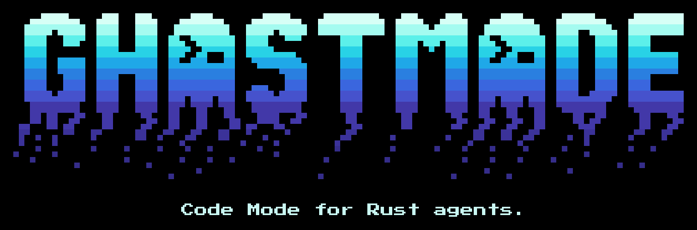

<p align="center"></p>
<p align="center"><a href="https://github.com/legend-of-alan/ghostmode/actions/workflows/ci.yml"></a> <a href="#license"></a> <a href="https://github.com/sponsors/legend-of-alan"></a></p>

# Ghost Mode

> Early days. The first real release is coming. The `0.0.1` crate on crates.io only reserves the name.

Let your agent write code instead of making tool calls one at a time. The core is async and doesn't tie you to a runtime.

## Why Code Mode

Normal tool calling is like giving someone directions one turn at a time. Code Mode hands them the whole route.

With normal tool calls, the model calls one tool, reads the whole result, then calls the next. Every result goes through the model, and each one costs tokens and a round trip. In Ghost Mode the model writes a short Python script instead. The script calls your tools, loops, filters and handles errors on its own, and only its result goes back to the model.

That adds up fast:

- **Way fewer tokens.** Anthropic cut one workflow from 150,000 tokens to 2,000 (98.7% less) by having the agent write code against its tools instead of loading every tool definition up front ([post](https://www.anthropic.com/engineering/code-execution-with-mcp)). Cloudflare fits its whole API, 2,500+ endpoints, into about 1,000 tokens, where plain MCP tools would take 1.17 million ([post](https://blog.cloudflare.com/code-mode-mcp/)).
- **Fewer steps, better results.** Models have read way more code than tool-call JSON. Across 17 models, CodeAct's code actions needed up to 30% fewer actions and scored up to 20 points higher success than JSON or text tool calls ([paper](https://arxiv.org/abs/2402.01030)).

Those are other teams' Code Mode numbers. Ghost Mode brings the same idea to Rust.

What it takes: give a `Sandbox` your tools, or point it at an MCP server, and hand the model two tool definitions, `execute` and `poll`. Monty runs the script inside your process, so there's no container or extra service. The script can only reach the outside world through your tools.

## How it works

<picture>
  <source media="(prefers-color-scheme: dark)" srcset="assets/how-it-works-dark.png">
  
</picture>

Here's who's who. Everything except the model and any MCP server lives in the caller's process.

- **The model** is the LLM. It runs at the model provider, never runs code, and only sees two tool definitions, `execute` and `poll`.
- **The caller** is your app, the agent loop. It owns a `Sandbox`, passes each `execute` or `poll` call from the model into it, and sends the `Status` JSON back.
- **The `Sandbox`** is a Ghost Mode library object in the caller's process. No separate service.
- **The script** is the Python the model wrote.
- **Monty** is the Python interpreter that runs the script, inside the caller's process.
- **The host** is the value you pass to `Sandbox::builder`. Its type implements `Host`, and it offers tools and answers calls to them.
- **A tool** is one function the host offers. The script calls it like a Python function, and the `Sandbox` turns that into `Host::call`. The host can do whatever it likes to answer, network calls included.
- **`mcp::Server`** is a ready-made host behind the `rmcp` feature. It wraps an rmcp client connection to an MCP server running somewhere else, and its tools are that server's tools.

Every arrow inside the caller's process is a plain Rust function call. The only network hops are caller to model provider, and `mcp::Server` to its MCP server.

## Usage

Write a host, build a `Sandbox`, and give the model the `execute` and `poll` definitions. When the model calls `execute`, pass its code to `Sandbox::execute` and send the `Status` JSON back. If the run is still going, the model calls `poll` with the `run_id`, and you pass that to `Sandbox::poll`.

```rust
use futures_util::future::{BoxFuture, FutureExt};
use ghostmode::host::{Call, Error, Host, Tool};
use ghostmode::{schema, Sandbox};
use serde_json::{json, Value};

struct Echo;

impl Host for Echo {
    fn tools(&self) -> Vec<Tool> {
        vec![Tool {
            id: "echo".into(),
            description: "Returns the text you pass it.".into(),
            input_schema: json!({
                "type": "object",
                "properties": { "text": { "type": "string" } },
                "required": ["text"],
            }),
        }]
    }

    fn call(&self, call: &Call) -> BoxFuture<'static, Result<Value, Error>> {
        let text = call.args.get("text").cloned().ok_or_else(|| Error::Failed("text is required".into()));
        async move { text }.boxed()
    }
}

let host = Echo;
let tools = schema::list_mcp_tools(&host.tools());
let mut sandbox = Sandbox::builder(host).build();
// Hand `tools` to the model. When it calls execute, run the code and send the Status JSON back.
let status = sandbox.execute("echo(text='hello')").await;
let reply = serde_json::to_value(&status).unwrap();
```

`schema::list_mcp_tools` gives you the pair in MCP shape, and `schema::list_openai_functions` gives them as OpenAI functions. With the `rmcp` feature on, pass an `mcp::Server` to `Sandbox::builder` instead of writing your own host.

## Build from source

All you need is [rustup](https://rustup.rs). It grabs the Rust version pinned in `rust-toolchain.toml`.

```sh
git clone https://github.com/legend-of-alan/ghostmode.git
cd ghostmode
cargo build --locked
cargo test --locked
```

Add `--all-features` to build the `rmcp` feature too. Fmt, clippy and the rest of CI live in [CONTRIBUTING.md](CONTRIBUTING.md).

## Contributing

Contributions are issues only for now. See [CONTRIBUTING.md](CONTRIBUTING.md).

## License

Licensed under [MIT](LICENSE).
