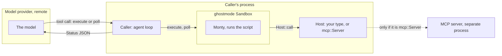

# ghostmode

Code Mode for Rust agents. The model writes a script, ghostmode runs it in a sandbox, and the host provides the tools the script calls. The core is async without tying you to a runtime.

## How it works

The model is the LLM. It runs at the model provider, not on your machine. It never runs code. It only sees two tools, `execute` and `poll`, and it sends back tool calls with `code` or a `run_id`.

The caller is your application, the agent loop. It owns a `Sandbox`. It passes each `execute` or `poll` call from the model into the `Sandbox`, then sends the resulting `Status` JSON back to the model.

The `Sandbox` is a ghostmode library object in the caller's process, not a separate service.

The script is the Python the model wrote. It runs inside Monty.

Monty is the Python interpreter. Today it runs inside the caller's process, in the same address space.

The host is the value the caller passes to `Sandbox::builder`. Its type implements `Host`, and it lives in the caller's process. It offers tools and answers calls to them.

A tool is one function the host offers. The script calls it as a Python function, and the `Sandbox` turns that into `Host::call`. Whatever the host does to answer runs in the caller's process, and it may reach out over the network.

`mcp::Server` is one ready-made host, offered when the `rmcp` feature is on. It wraps an rmcp client connection to an MCP server that runs elsewhere, in another process or on another machine. Its tools are that server's tools.

Every arrow inside the caller's process is a plain Rust function call. The only network hops are caller to model provider, and host to MCP server when the host is `mcp::Server`.

Early days: the design is underway and the first real release is coming. The `0.0.1` crate on crates.io only reserves the name.

Licensed under MIT.
