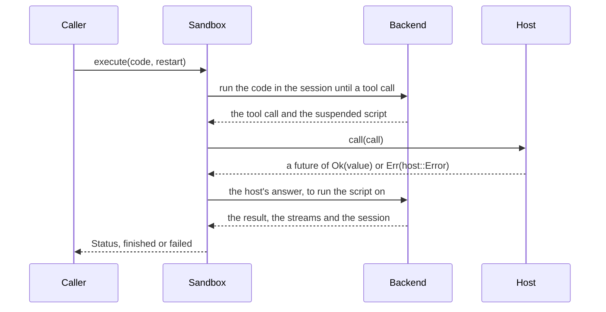

# Writing a host

A host decides which tools a script can call, and answers each call. Write one to offer your own tools. It implements the `Host` trait in `src/host.rs`, and you pass it to `Builder::new` along with a backend that runs the script. The `monty` feature, on by default, adds `backend::Monty`, and the `monty-pool` feature adds `backend::MontyPool`. [Where scripts run](#where-scripts-run) compares them.

The README and this guide use these words:

- The model is the LLM at the model provider. It never runs code and only sees the definitions of `execute` and `poll`, the two functions the model calls.
- The caller is your app, the agent loop. It owns a `Sandbox`, passes each `execute` or `poll` call from the model into it, and sends the `Status` JSON back.
- The `Sandbox` is a library object in the caller's process, not a separate service.
- The script is the Python the model wrote.
- Monty is the Python interpreter that runs the script.
- The host is the value you pass to `Builder::new`, along with the backend. Its type implements `Host`.
- A tool is one function the host offers. The script calls it like a Python function, and the `Sandbox` turns the call into `Host::call`. The host can do anything to answer, network calls included.
- `mcp::Server` is a ready-made host behind the `rmcp` feature. It wraps an rmcp client connection to an MCP server that runs somewhere else, and its tools are that server's tools.

## Where scripts run

`Monty` runs the script inside the caller's process, on the thread that polls `Sandbox::execute` or `Sandbox::poll`. That thread runs nothing else until the script calls a tool or ends, for up to `Limits::run_time` in total, 30 s by default. On Tokio, call `execute`, `poll`, `Sandbox::dump` and `Builder::restore` inside `spawn_blocking` or `block_in_place`, so a script doesn't stall the runtime's other tasks.

`Monty` isn't crash-isolated. A script, or a dump restored without a signing key, can panic, abort or hang the caller's process.

`MontyPool`, behind the `monty-pool` feature, runs each session in its own `monty` worker process from monty-pool. A crash ends only that worker, and the next status says the session restarted. It needs a Tokio multi-thread runtime. Its rustdoc says what still runs on the polling thread and how the pool counts workers.

## What happens during one execute

When the caller passes the model's code to `Sandbox::execute`, the `Sandbox` has the backend run the script. The backend runs the script until it calls a tool. The `Sandbox` asks the host for the answer and hands it back to the backend. This repeats until the script ends.



A script can call tools many times. Each tool call adds one more round of the tool call, the host's answer and running on, before the script ends with its result.

The `Sandbox` waits for the host's answer only up to the wait set by `Builder::execute_wait`. If the wait ends first, `execute` returns a `running` status, and the run stays suspended. A later `Sandbox::poll` waits on the same answer and runs the script on from there.

## Write a host

A host is any type that implements `Host`. The trait has two methods.

`tools` returns the tools a script may call, as a `Vec<Tool>`. Each `Tool` has three fields:

- `id` is the name the script calls the tool by, as a Python function. Use a Python identifier that is not a Python keyword, such as `add_note`, and check it with `schema::is_python_identifier`. The `execute` description that `schema::mcp_definitions` writes leaves out any tool whose id is not one.
- `description` tells the model what the tool does.
- `input_schema` is the JSON Schema of the tool's keyword arguments.

`call` answers one tool call. It gets a `Call` with the `tool_id` and the keyword `args` as a JSON object. It returns a future of `Result<Value, host::Error>`:

- An Ok value is the tool's return value. The script gets it as a Python value.
- A Refused error means the host would not run the call. The script sees a PermissionError with the reason.
- A Failed error means the call ran and failed. The script sees a RuntimeError with the message.

This host keeps a list of notes. It offers `add_note` and `list_notes`, and it refuses `add_note` when it is read-only:

```rust
use std::sync::{Arc, Mutex};

use futures_util::future::{self, BoxFuture, FutureExt};
use ghostmode::Builder;
use ghostmode::backend::Monty;
use ghostmode::host::{self, Call, Host, Tool};
use serde_json::{Value, json};

struct Notes {
    notes: Arc<Mutex<Vec<String>>>,
    read_only: bool,
}

impl Host for Notes {
    fn tools(&self) -> Vec<Tool> {
        let note_schema = json!({
            "type": "object",
            "properties": { "text": { "type": "string" } },
            "required": ["text"],
        });
        vec![
            Tool::new("add_note", "Saves a note.", note_schema),
            Tool::new("list_notes", "Returns every saved note.", json!({ "type": "object" })),
        ]
    }

    fn call(&self, call: &Call) -> BoxFuture<'static, Result<Value, host::Error>> {
        let answer = match call.tool_id.as_str() {
            "add_note" if self.read_only => Err(host::Error::Refused("notes are read-only".into())),
            "add_note" => match call.args.get("text").and_then(Value::as_str) {
                Some(text) => {
                    self.notes.lock().unwrap().push(text.to_string());
                    Ok(Value::Null)
                }
                None => Err(host::Error::Failed("text must be a string".into())),
            },
            "list_notes" => Ok(json!(*self.notes.lock().unwrap())),
            other => Err(host::Error::Failed(format!("no tool has the id {other}"))),
        };
        future::ready(answer).boxed()
    }
}

async fn add_and_list_notes() {
    let host = Notes { notes: Arc::default(), read_only: false };
    let mut sandbox = Builder::new(host, Monty).build().await;
    let status = sandbox.execute("add_note(text='hi')\nlist_notes()", false).await;
}
```

The `status` serializes as `{"status": "finished", "value": ["hi"]}`.

For a host that does real I/O, see `mcp::Server` in `src/mcp.rs`. It clones what it needs out of `self` and `call`, then sends the call to an MCP server inside an `async move` block.

### Rules for a host

- **The future owns its data.** `call` returns a `'static` future, so it can't borrow `self` or `call`. Clone what the future needs before you build it, as `mcp::Server` clones its rmcp peer.
- **The future may be dropped.** The `Sandbox` drops the future when the call passes `call_timeout`, when the caller calls `Sandbox::cancel` or `Sandbox::reset`, and when the run passes `idle_timeout`. Don't rely on the future running to the end.
- **The tool list is read once.** `Builder::new` calls `tools` once, `Sandbox::tools` returns that list, and the `Sandbox` hands that list to the backend. A tool that `tools` adds later is not callable in that `Sandbox`, so build a new one.
- **Arguments are keywords.** Monty raises TypeError for a positional argument before the call reaches the host, so `call.args` holds every argument.
- **Keys come sorted.** Objects in `call.args`, the host's answers and the script's results come with their keys sorted. To keep insertion order, turn on serde_json's `preserve_order` feature in your own `Cargo.toml`.
- **Answer every call.** Use Refused for a call the host won't run, such as one without permission. Use Failed for a call that ran and went wrong. Answer an unknown `tool_id` with Failed, as `mcp::Server` does.
