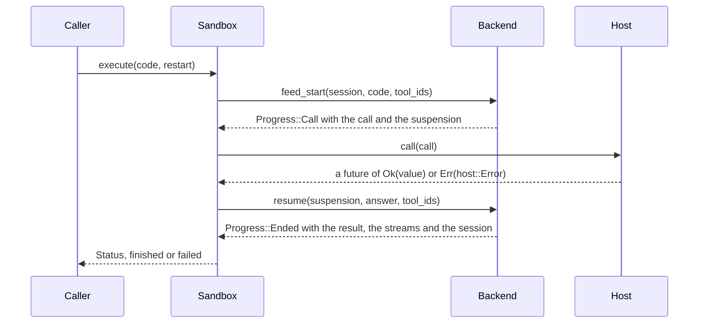

# Writing a host or a backend

A `Sandbox` works with two parts that you can replace:

- **The host** decides which tools a script can call, and answers each call. Write one to offer your own tools. It implements the `Host` trait in `src/host.rs`.
- **The backend** runs the script. Write one to run scripts in another interpreter or another process. It implements the `Backend` trait in `src/backend.rs`.

If you only want to offer tools, you only need a host. The default backend, `Monty`, runs scripts in Monty inside the caller's process. The `monty-pool` feature adds `backend::MontyPool`, which runs each session in its own Monty worker process.

This guide uses the same words as the README. The model is the LLM at the model provider. The caller is your app, the agent loop. The `Sandbox` is the library object in the caller's process. The script is the Python the model wrote. Monty is the Python interpreter. The host is your `Host` value, and a tool is one function the host offers.

## What happens during one execute

When the caller passes the model's code to `Sandbox::execute`, the `Sandbox` has the backend run the script. The backend runs the script until it calls a tool. The `Sandbox` asks the host for the answer and hands it back to the backend. This repeats until the script ends.



A script can call tools many times. Each tool call adds one more round of Progress::Call, the host's answer and `resume` before the script ends with Progress::Ended.

The `Sandbox` waits for the host's answer only up to the wait set by `Builder::execute_wait`. If the wait ends first, `execute` returns a `running` status, and the run stays suspended. A later `Sandbox::poll` waits on the same answer and runs the script on from there.

## Write a host

A host is any type that implements `Host`. The trait has two methods.

`tools` returns the tools a script may call, as a `Vec<Tool>`. Each `Tool` has three fields:

- `id` is the name the script calls the tool by, as a Python function. Use a Python identifier that is not a Python keyword, such as `add_note`. The `execute` description that `schema::list_mcp_tools` writes leaves out any tool whose id is not one.
- `description` tells the model what the tool does.
- `input_schema` is the JSON Schema of the tool's keyword arguments.

`call` answers one tool call. It gets a `Call` with the `tool_id` and the keyword `args` as a JSON object. It returns a future of `Result<Value, host::Error>`:

- An Ok value is the tool's return value. The script gets it as a Python value.
- A Refused error means the host would not run the call. The script sees a PermissionError with the reason.
- A Failed error means the call ran and failed. The script sees a RuntimeError with the message.

This host keeps a list of notes. It offers `add_note` and `list_notes`, and it refuses `add_note` when it is read-only:

```rust
use std::sync::{Arc, Mutex};

use futures_util::future::{self, BoxFuture, FutureExt};
use ghostmode::Sandbox;
use ghostmode::host::{Call, Error, Host, Tool};
use serde_json::{Value, json};

struct Notes {
    notes: Arc<Mutex<Vec<String>>>,
    read_only: bool,
}

impl Host for Notes {
    fn tools(&self) -> Vec<Tool> {
        vec![
            Tool {
                id: "add_note".into(),
                description: "Saves a note.".into(),
                input_schema: json!({
                    "type": "object",
                    "properties": { "text": { "type": "string" } },
                    "required": ["text"],
                }),
            },
            Tool {
                id: "list_notes".into(),
                description: "Returns every saved note.".into(),
                input_schema: json!({ "type": "object" }),
            },
        ]
    }

    fn call(&self, call: &Call) -> BoxFuture<'static, Result<Value, Error>> {
        let answer = match call.tool_id.as_str() {
            "add_note" if self.read_only => Err(Error::Refused("notes are read-only".into())),
            "add_note" => match call.args.get("text").and_then(Value::as_str) {
                Some(text) => {
                    self.notes.lock().unwrap().push(text.to_string());
                    Ok(Value::Null)
                }
                None => Err(Error::Failed("text must be a string".into())),
            },
            "list_notes" => Ok(json!(*self.notes.lock().unwrap())),
            other => Err(Error::Failed(format!("no tool has the id {other}"))),
        };
        future::ready(answer).boxed()
    }
}

let host = Notes { notes: Arc::default(), read_only: false };
let mut sandbox = Sandbox::builder(host).build().await;
let status = sandbox.execute("add_note(text='hi')\nlist_notes()", false).await;
```

The `status` serializes as `{"status": "finished", "value": ["hi"]}`.

For a host that does real I/O, see `mcp::Server` in `src/mcp.rs`. It clones what it needs out of `self` and `call`, then sends the call to an MCP server inside an `async move` block.

### Rules for a host

- **The future owns its data.** `call` returns a `'static` future, so it can't borrow `self` or `call`. Clone what the future needs before you build it, as `mcp::Server` clones its rmcp peer.
- **The future may be dropped.** The `Sandbox` drops the future when the call passes `call_timeout`, when the caller calls `Sandbox::cancel` or `Sandbox::reset`, and when the run passes `idle_timeout`. Don't rely on the future running to the end.
- **The tool list is read once.** `Builder::new` calls `tools` once, and the `Sandbox` hands the tool ids to the backend. A tool that `tools` adds later is not callable in that `Sandbox`, so build a new one.
- **Arguments are keywords.** Monty raises TypeError for a positional argument before the call reaches the host, so `call.args` holds every argument.
- **Answer every call.** Use Refused for a call the host won't run, such as one without permission. Use Failed for a call that ran and went wrong. Answer an unknown `tool_id` with Failed, as `mcp::Server` does.

## Write a backend

A backend is any type that implements `Backend`. The backend holds no session itself. The `Sandbox` keeps the idle session, or the suspended script, between calls. `feed_start` and `resume` take it by value and hand it back inside a `Progress`, and `abort` hands it back inside an `Ending`.

The trait has two associated types, and both must be Send:

- `Session` is a Python session between scripts. It holds the globals that scripts set.
- `Suspension` is a script stopped at a tool call. It also holds what the script has printed so far.

It has seven methods. Each returns a future that must be Send.

- `new_session(limits)` makes an empty idle session. The session must stop a script that goes past the run time, memory or recursion depth in `limits`.
- `feed_start(session, code, tool_ids)` runs `code` in the idle session. It returns Progress::Call when the script calls one of the host's tools, whose ids are `tool_ids`, and Progress::Ended when the script ends.
- `resume(suspension, answer, tool_ids)` gives the host's answer to the suspended call and runs on. An Ok value becomes the call's return value. A Refused error raises PermissionError, and a Failed error raises RuntimeError.
- `abort(suspension, message, tool_ids)` ends the suspended script with a RuntimeError that carries `message`, and returns its `Ending`. The script can't catch this error.
- `abandon(suspension)` drops the suspended script without running it further. It returns the idle session, with the globals the script set, and the `Streams` the script printed.
- `dump(session)` returns the idle session as bytes, or an error for a session it can't write.
- `restore(bytes, limits)` loads the bytes from `dump` as an idle session, or returns an error for bytes it can't load.

Every `Progress` is one of two variants:

- Progress::Call carries the `host::Call` and the `Suspension`. The `Sandbox` sends the call to the host and passes the answer to `resume`.
- Progress::Ended carries an `Ending`, which holds the `result`, the `streams`, the idle `session` and whether the session `restarted`. The `result` is Ok with the value of the script's last expression as JSON, or Err with the script's traceback as text.

The toy backend below treats the whole script as one tool id. It calls that tool with no arguments, and the script's value is the tool's answer. It has no globals, so its `Session` and `Suspension` are `()`.

```rust
use std::error;

use ghostmode::backend::{Backend, Ending, Progress, Streams};
use ghostmode::host::{self, Call};
use ghostmode::{Builder, Limits};
use serde_json::{Map, Value};

struct OneCall;

impl Backend for OneCall {
    type Session = ();
    type Suspension = ();

    async fn new_session(&self, _limits: &Limits) {}

    async fn feed_start(&self, session: (), code: &str, tool_ids: &[String]) -> Progress<Self> {
        let tool_id = code.trim().to_string();
        if !tool_ids.contains(&tool_id) {
            let result = Err(format!("NameError: name '{tool_id}' is not defined"));
            let streams = Streams::default();
            return Progress::Ended(Ending { result, streams, session, restarted: false });
        }
        let call = Call { tool_id, args: Map::new() };
        Progress::Call { call, suspension: () }
    }

    async fn resume(
        &self,
        _suspension: (),
        answer: Result<Value, host::Error>,
        _tool_ids: &[String],
    ) -> Progress<Self> {
        let result = answer.map_err(|error| match error {
            host::Error::Refused(reason) => format!("PermissionError: {reason}"),
            host::Error::Failed(message) => format!("RuntimeError: {message}"),
        });
        Progress::Ended(Ending { result, streams: Streams::default(), session: (), restarted: false })
    }

    async fn abort(&self, _suspension: (), message: String, _tool_ids: &[String]) -> Ending<Self> {
        let result = Err(format!("RuntimeError: {message}"));
        Ending { result, streams: Streams::default(), session: (), restarted: false }
    }

    async fn abandon(&self, _suspension: ()) -> ((), Streams) {
        ((), Streams::default())
    }

    async fn dump(&self, _session: &mut ()) -> Result<Vec<u8>, Box<dyn error::Error + Send + Sync>> {
        Ok(Vec::new())
    }

    async fn restore(
        &self,
        _bytes: &[u8],
        _limits: &Limits,
    ) -> Result<(), Box<dyn error::Error + Send + Sync>> {
        Ok(())
    }
}

let mut sandbox = Builder::new(host, OneCall).build().await;
```

`Sandbox::builder` only builds a `Sandbox` with `Monty`. For your own backend, use `Builder::new` with the host and the backend. The other `Builder` settings work the same.

For the real reference, see `Monty` in `src/backend/monty/in_process.rs`. Its `run` method shows how to turn every way Monty can stop into either a Progress::Call or an answer that Monty gets at once. `MontyPool` in `src/backend/monty/pool.rs` does the same over a worker process, and shows a backend that can lose its session.

### Rules for a backend

- **Stop only for the host's tools.** Return Progress::Call only for a call to one of the host's tools, with keyword arguments only. The `Sandbox` passes the host's tool ids to `feed_start`, `resume` and `abort`. Answer everything else inside the backend. `Monty` raises NameError for an unknown name, TypeError for a positional argument and RuntimeError for an awaited tool, and it gives every OS call the no-handler answer.
- **An `Ending` carries everything the run produced.** The `session` is idle and keeps the globals the script set, even when the script failed. A backend that loses the globals, as `MontyPool` does when its worker crashes, gives back an empty session and sets `restarted` on the next script's `Ending`, so that script's status says the session restarted. The `streams` hold everything the script printed during the whole run, across every `resume`. The `Sandbox` puts the Err text in the `failed` status's `error`, so make it the traceback you want the model to read.
- **`abort` ends the script.** The script can't catch the error, so `abort` returns an `Ending`, never a tool call. The `Sandbox` calls it when the script reaches `calls_per_execute` and when a call passes `call_timeout`.
- **The backend enforces three limits.** `new_session` and `restore` get the `Limits`. The session stops a script at `run_time`, `memory_bytes` and `recursion_depth`. `run_time` counts only the script's own time, summed over the whole run, and not the time it waits on the host. The `Sandbox` enforces `calls_per_execute`, `call_timeout`, `idle_timeout` and `output_chars` itself.
- **`dump` and `restore` work on idle sessions only.** The `Sandbox` calls `dump` only when no run is open, and hands an error from `dump` to the caller as Error::Dump. `restore` uses the `limits` it gets, not the limits the session was dumped with. When the caller sets `Builder::signing_key`, the `Sandbox` adds and checks the signature, so the backend sees only its own bytes.
- **Without a signing key, `restore` gets bytes it can't trust.** Return an error for bytes you can't load. If a bad dump can crash or hang your backend, say so in its docs, as `Monty` does.
